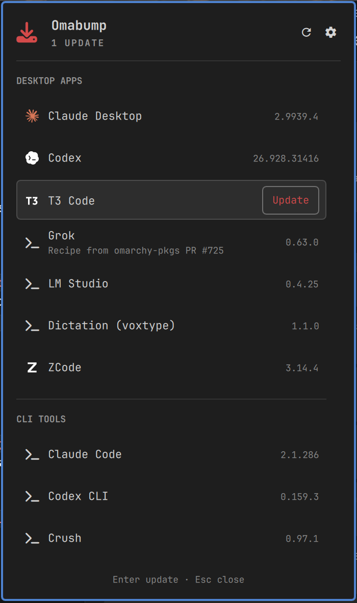
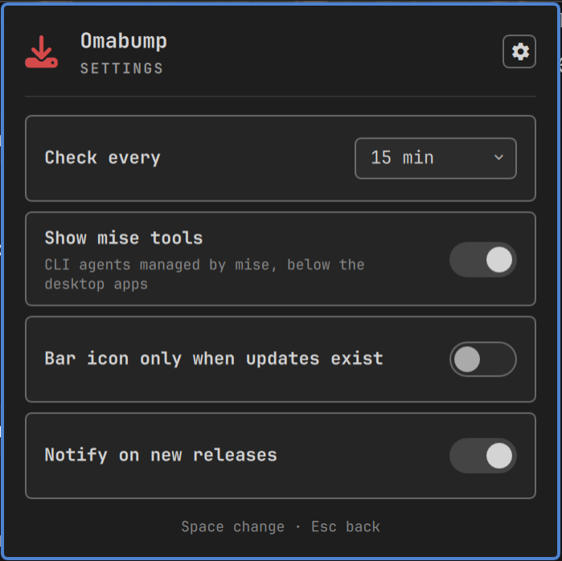

# Omabump

Agent desktop apps and CLIs at the version the vendor shipped, ahead of the Omarchy repo.



An Omarchy bar widget. It lists the agent desktop apps and agent CLIs installed on this machine, the installed and the newest version of each, and installs the newest version in a terminal when you press Update. It never installs anything on its own. The project was previously called Agent Apps.

## Prerequisites

- `base-devel` (makepkg, sudo) and `git`
- `jq`, `curl`, `python` 3.11 or newer, `libarchive` (`bsdtar`): what omarchy-pkgs' `bin/sync-upstream` needs
- sudo rights for `pacman -U`
- `mise`, optional, for the agent CLIs
- `7zip`, optional, to read the version of an app installed as its self-updating AppImage (T3 Code); without it that row shows "version unknown"

When something is missing, omarchy rows have no Update button and say what to install, for example "Missing: makepkg, jq; sudo pacman -S --needed base-devel jq".

## Install

```sh
omarchy plugin add https://github.com/vladkarok/omabump.git --enable
```

`omarchy plugin add` asks for confirmation; from a script pass `--yes`.

The widget lands in the bar's right section. Move it with `omarchy bar move io.github.vladkarok.omabump --section center --index 0` (sections: left, center, right).

## Using it

The bar icon turns the urgent colour when an app can be updated. Left click opens the panel, middle or right click checks now. The tooltip and the panel header say one of: all current, N updates, check failed, last known (rows that keep an earlier run's version because this run could not get one), or "All checked current, N unchecked" (rows whose newest version is not known: CLI tools whose update check was skipped, see How CLI tools are found; a self-updating app's pre-release or unknown version; a version the local refresh found that no check has read yet), plus "(+N muted/skipped)" when quiet rows have updates. A failed or skipped check never reads as up to date; the one exception is a row you muted (see Mute). A check that stopped part way, killed or interrupted, says so in every bar, whoever started it.

A check that failed (the summary says "Check failed": offline after a resume, a feed that timed out, a run that stopped early) is tried once more about 5 minutes after it started, instead of a whole interval later. If that one fails too, the next check comes the usual interval after it, so an outage, or a GitHub rate limit that lasts the hour, is not asked again every few minutes. A muted row's failure earns no retry. Each bar asks once a minute whether a check is due, counting from the last check's start in status.json, which all bars share.

A check you ask for with a click or `r` while one runs is not lost: a check that starts after your request answers it (yours, or another bar's or a terminal's that takes the lock first). IPC `refresh` does the same unless it is throttled (see Keys). If the running check holds its lock for over 11 minutes, yours is not run, and the panel says "Check not run: another check held the lock for over 11 min" until a later check completes. The timer's own check skips while any check runs. Turning Show mise tools on or off also checks again, after any check in progress.

Between checks, apps also change outside Omabump: Omarchy updates a mise CLI when it launches, and `omarchy update` runs `mise up` and pacman. So the panel rereads the installed versions, offline, when it opens (or runs the full check instead, when one is due) and, while the bar counts an update, every 5 minutes: with no update shown there is nothing a refresh could take back, and nothing runs between checks. That local refresh reads `pacman -Q`, `mise ls` (offline), Omabump's own `manifest.json` and a self-updating app's AppImage version, as the check reads them; it keeps everything else the last check found, and never notifies. A version it cannot judge on its own (past the newest known one, a mise tool at another version, an app new since the check or moved between package and AppImage) shows "Not checked yet" and starts one full check. Another package name, or a mise tool that reached the newest known version, shows as read and starts one too. It never moves "checked N min ago" or puts off the next check.

The panel has three sections: Desktop apps, CLI tools and Plugin (Omabump itself, only while it has an update or its check failed, see Updating Omabump). Apps are found with `pacman -Q` (exact package names) and CLIs with `mise ls`. A row shows the installed version, or `installed → newest` when there is an update. A second line appears only for an exception: a pin, a recipe from an open omarchy-pkgs PR, another package name, a failed check, no install route. The row's tooltip says where the version came from and what Update runs, or why there is no Update.

### Keys

Arrows or `j` and `k` select a row, `Enter` updates it (or asks the agent on a row without Update), `w` switches the package, `c` copies the agent prompt, `m` mutes or unmutes the row, `K` (Shift+k) skips or unskips its newest version (with CapsLock on, `j` and `k` still move the cursor), `r` checks now, `s` opens the settings, `Esc` closes. The selected row always scrolls into view. The panel opens on the first row with something to do. As the rows change (a check, or the refresh on open), the cursor goes to whichever row has something to do first until you move it or act on a row; after that it stays on that app. A pointer at rest over the rows does not move it.

IPC: `omarchy-shell io.github.vladkarok.omabump status|open|close|toggle|refresh|settings`. `status` counts what the bar counts, including unchecked rows, and adds "(+N muted/skipped)" when quiet rows have updates, with "check failed for N muted apps" inside it when muted rows failed. `refresh` answers `throttled` and starts nothing while this bar's own Refresh check runs or within a minute after its last check ended (a run that left because another check held the lock, or never ran, does not count); during another bar's or a terminal's check it waits for that one and then checks. `open`, `close`, `toggle` and `settings` go through the shell's own panel handling, as `omarchy-shell shell toggle io.github.vladkarok.omabump` does, so the panel opens on the focused monitor (or the open one closes), whichever monitor's bar received the call. The check interval is kept between 60 seconds and a day.

The last check's result is `~/.local/state/omarchy/plugins/io.github.vladkarok.omabump/status.json`, with a top-level `schemaVersion` (1). A row's `note` holds only its exceptions; that a package is installed under another name is in `installedName`, `switchable`, `updateAvailable` and `installable`, and the panel writes the "Installed as ..., switch to ..." text from them. `inventoryAt` says when the installed versions were last read: a full check's start, or a local refresh. `retry` is true when the check was the widget's retry of one that failed (`bin/omabump-check --retry`). `selfUpdating` marks a row for an app that updates itself (see Self-updating apps); its `installedName` is the AppImage's or npm package's path as apps.json writes it, and `installed` is empty when the version is unknown.

### Settings

The gear in the panel header (or `s`) opens the settings: check interval (an hour by default, five minutes at the least), show mise tools, bar icon only when updates exist (it also shows while a check fails), notify on new releases. Each new version is announced once.



The scripted equivalent:

```sh
omarchy bar set io.github.vladkarok.omabump <key> <value> --json
```

with the keys `refreshIntervalSec` (seconds), `showMise`, `barIconOnlyWithUpdates` and `notify`. Without `--json` the value is stored as a string; `"true"` and `"false"` are read as booleans.

### Mute

Mute (`m`, or the 󰖁 button on the row under the cursor) keeps a row in the list, dimmed with the same glyph after its name, and takes it out of every signal: no badge, no update count, no urgent icon, no reason to show the bar icon when it is hidden until an update, no notification. A muted row's failed check shows only on the row itself ("Check failed: ...") and in the tooltip and IPC status ("check failed for N muted apps"), not in the header or the bar; an omarchy-pkgs or mise failure that only muted rows share does not fail the check. Its update stays visible and Update and Enter still work. Mute again to undo, or Clear in the settings, which list the muted rows the last check showed (a mute for a row hidden by Show mise tools is kept, not listed). The list is the widget setting `mutedApps`, an array of row ids (`pkg`), set with `omarchy bar set io.github.vladkarok.omabump mutedApps '["mise:grok-cli"]' --json`.

### Skip a version

On a row with an update, Skip (`K`, Shift+k since `k` moves the cursor, or the 󰒭 button) silences that one version the same way: the row shows `installed → newest skipped`, dimmed, and Update still works. When a newer version than the skipped one appears, or that version or a later one is installed, the skip no longer applies: the row counts and notifies again (once) for a newer release, the settings stop listing the skip, and it is dropped the next time the panel writes a setting. A skip on a row the last check could not judge (failed, stale, still checking, unchecked or not listed) is kept. pacman and feed versions are compared with `vercmp`, so a feed that rolls back below the skipped version stays skipped; mise and Omabump's own versions must match exactly, so `1.0.0` after a skipped `1.0.0-beta.1` is new. Skip again to undo. The setting is `skippedVersions`, an object of row id to version: `omarchy bar set io.github.vladkarok.omabump skippedVersions '{"grok-bot": "0.66.0"}' --json`.

Omarchy's settings schema has no array or object type, so `mutedApps` and `skippedVersions` appear only in the panel's own settings (one line, with Clear), not in the bar's widget settings.

Mute, skip, Notify and Show mise tools apply to every check, whoever starts it: the shell's timer, `bin/omabump-check` in a terminal, or the refresh after an Update. The checker reads them itself from the widget's entry in `~/.config/omarchy/shell.json` (in `bar.layout` or the top-level `plugins` list), up to 1 MiB of file and 200 entries each; an id or version it does not accept is ignored with a line in the shell log. `--no-notify` and `--no-mise` still win, and the settings are read once the check holds its lock. Run by hand, `bin/omabump-check` exits 0 when it ran a check, 75 when it did not because another check holds the lock (one line on stderr; `--wait` runs one after it instead, and exits 75 if that wait passes 11 minutes), and anything else when the check failed (status.json's `runError` says how). A check that finds a local refresh holding the lock waits for it (at most 130 seconds) and then runs. `bin/omabump-check --local` is the local refresh: it exits 0 when done, 80 when a change needs a full check, 81 without a finished check's status.json to start from, 82 while pacman is mid-transaction (it writes nothing then), and 75 when a check or another local refresh holds the lock.

## Supported apps

| Package | App | Route |
|---|---|---|
| `claude-desktop` | Claude Desktop | omarchy |
| `openai-codex-desktop` | Codex (also found as AUR `chatgpt-desktop`) | omarchy |
| `t3code-bin` | T3 Code | omarchy as the `t3code-bin` package; once Omarchy's migration 1792345511 replaces it with T3 Code's self-updating app, the row shows that app's version and no Update (it updates itself) |
| `hermes-desktop` | Hermes | omarchy, no Update until the recipe has an upstream watch |
| `grok-bot` | Grok | omarchy |
| `lmstudio-bin` | LM Studio | omarchy |
| `openclaw` | OpenClaw | omarchy as the `openclaw` package, no Update (it is the seed of OpenClaw's own copy); once Omarchy's migration 1792334754 sets that copy up in `~/.openclaw`, the row shows its version and no Update (it updates itself) |
| `perplexity` | Perplexity | omarchy |
| `zcode` | ZCode (also found as AUR `z-code-bin`) | vendor |
| `antigravity` | Antigravity (or `antigravity-appimage`) | indicator, version from the AUR; `omarchy update` updates it |
| `antigravity-ide` | Antigravity IDE | indicator, version from the AUR; `omarchy update` updates it |
| `kimi-bin` | Kimi | indicator, version from Moonshot's update feed |
| `trae-bin` | Trae | indicator, version from the AUR; `omarchy update` updates it |

mise tools, listed when mise has them installed and active: Claude Code, Codex CLI, Crush, OpenCode, Grok CLI, Copilot CLI, Cursor CLI, Pi, Oh My Pi, Ori, Antigravity CLI, Amp, Qwen Code, Kilo, Kiro CLI, Devin CLI, DeepSeek Harness, MiniMax Code, Command Code, Freebuff, Muse Code, Kimi CLI, Gemini CLI, Jules and herdr (see How CLI tools are found).

### How CLI tools are found

Each CLI row is a `mise` entry of `apps.json` that names the keys mise may have the tool under (`"tool": ["claude", "npm:@anthropic-ai/claude-code"]`). The first of them `mise ls` reports as installed and active is the row's tool; a tool mise does not have shows no row. The shipped entries cover the agents Omarchy's menu offers and a few more. An agent Omarchy adds later needs an entry: until a release has it, add one to your own `apps.json` (see Adding an app).

Until 0.1.13 Omabump found the agents itself, in Omarchy's menu and the wrappers Omarchy wrote to `~/.local/bin`. Omarchy 4 renamed the menu's entries and no longer writes those wrappers, so the list is now the only source.

Every mise call Omabump makes, in the check and in Update, runs with `MISE_DISABLE_BACKENDS` set to `asdf`, `vfox` and the name of every plugin in mise's plugins directory (a vfox backend plugin is disabled by its own name), plus the backends you disabled yourself (your `MISE_DISABLE_BACKENDS` and mise's `disable_backends` setting, read once per run with `mise settings get`), so a tool named with an `asdf:`, `vfox:` or plugin backend runs no plugin script while mise resolves your config; `mise ls` still lists such a tool. A bare name that mise resolves to an installed asdf plugin is not covered: when its configured version is not installed, mise may run that plugin's version-listing script (once per mise cache period). `mise outdated` is asked only about the key each row resolved to, and only when one `mise ls --backend` call puts it on a backend agent CLIs ship on: aqua, github, gitlab, forgejo, npm, http, ubi, pipx, cargo. A tool on any other backend (asdf, vfox, another plugin, or mise's core, go and gem) shows its installed version and "Update check skipped", has no Update button and counts as unchecked in the summary. When `mise ls` fails (a broken mise config), or `mise outdated` cannot fetch a tool's versions (offline, rate limited; mise still exits 0 then, and for a pinned or ranged request names only the backend's tool, `openai/codex` for `codex`), the rows keep the last known version and the check reads as failed.

## How Update works

Update opens a floating terminal and runs `bin/omabump-install <pkg>`. The row's route decides what happens.

**omarchy.** The apps behind Omarchy's Install > AI menu come from the [omarchy] pacman repo, built from the recipes in [omacom/omarchy-pkgs](https://github.com/omacom/omarchy-pkgs). That repo notices a vendor release within hours (hourly for most of these apps, every six hours for the rest), and its bot's version bumps merge on their own once CI passes, so the repo usually follows within hours, a day later for a recipe that holds new releases. Omabump covers those hours, and a bump whose CI fails and waits for a person. Update checks out the pinned omarchy-pkgs commit (see Pinned snapshots) detached in `~/.cache/omabump/omarchy-pkgs`, runs its `bin/sync-upstream <pkg>`, prints the recipe diff (normally `pkgver` and checksums), checks that the recipe builds the expected package at a full version newer than the installed one (when it is not, see Already installed), builds it with `makepkg` and installs it with `sudo pacman -U`. The sync tool and the recipe's hook have run by the time the diff shows, so read the diff as a record. pacman asks before it installs; that prompt is the point where you can still stop.

A recipe may hold new releases for a while (`min_release_age`), and `bin/sync-upstream` does not move it to a younger release. Such a row shows the update, without an Update button or a notification, and says from when Update works. A feed gives no release date, so the wait counts from the first check that saw the version.

Update is off for the `openclaw` package. Since [omarchy-pkgs#797](https://github.com/omacom/omarchy-pkgs/pull/797) it is no longer OpenClaw itself but the seed of a copy in `~/.openclaw` that updates itself (`openclaw update`, or Update in its Control UI), which Omarchy's migration 1792334754 or `omarchy-install-openclaw-cli --now` sets up. Built from the pinned recipe, Update would take OpenClaw out of `/usr` on a machine that still runs it from there, before Omarchy has moved it. `omarchy update` updates the seed with the rest; the copy's row is under Self-updating apps.

A local build says `Packager: Unknown Packager` in `pacman -Qi`. pacman replaces it with the repo package once the repo's full version is higher, and `sudo pacman -S <pkg>` puts the repo package back at any time. Switching Omarchy's channel (`omarchy channel set`) runs `pacman -Syyuu --noconfirm`, which also puts the repo's older version back, without asking.

**vendor.** The vendor publishes a ready Arch package (ZCode does). `apps.json` gives its URL and a feed for the newest version. When the feed's version is not newer than the installed one, Update ends as under Already installed, before it reads the package URL or checksum; otherwise it downloads the file over HTTPS, and verifies it against the sha512 the vendor lists for that exact file in its update manifest. It refuses if the manifest has no checksum for the file, and deletes a file that does not match. Then `pacman -Qp` checks the package name and full version, the installed version is read again, and only then is the file staged and installed with `sudo pacman -U`, after pacman asks. pacman does not fetch the URL itself because it would check a remote file against `SigLevel = Required`, and the vendor does not sign the package. On a fresh install ZCode's install script links `/usr/bin/zcode` to `/opt/ZCode/zcode`, and no package owns that link, so pacman refuses the AUR's `zcode` (which ships that path) and `omarchy update` fails. After a vendor install Omabump therefore removes `/usr/bin/<pkg>` with `sudo rm` when it is a link no package owns, pointing at a file of the package just installed. While the vendor build is installed, `zcode` is not on PATH: start ZCode from the app launcher or run `/opt/ZCode/zcode`. If Omabump falls behind or is uninstalled, a normal update replaces the vendor build with the AUR's `zcode`, which brings `/usr/bin/zcode` back.

**mise.** The check asks `mise outdated` for the version each tool's configured request reaches, and Update installs exactly that version with `mise install <tool>@<version>` in `$HOME`, with asdf and vfox disabled; your config is not touched, and its request makes the new version the active one (a `latest` request uses the newest version installed, which is also what Omarchy's wrappers then run). Both run with `MISE_MINIMUM_RELEASE_AGE=0`, as Omarchy's own agent wrappers and `omarchy update` do, so an agent CLI's new release shows and installs at once. Finding it skips mise's versions host (`mise-versions.jdx.dev`), which can list a release hours after its tag (Codex 0.164.0: more than nine hours): mise asks each installed tool's own source instead, one light request per tool (GitHub's `/releases/latest` for aqua and github tools), cached for an hour, and never resolves the tools your config names but you have not installed (they are passed to mise as `MISE_DISABLE_TOOLS`, with the ones you disabled yourself; not to Update's install, which rewrites every tool's shims, and an unused tool's shim is how Omarchy installs it on first use). That is one request per installed tool an hour for a `latest` request; a pinned or ranged one makes mise list the tool's releases, for aqua and github tools GitHub's whole paged list. Installing goes through the host: there mise maps the version to its release from the host's cache, where GitHub's own list of a tool's releases can be tens of MB (45 MB for Codex) and often times out. So while the host answers, Update needs no GitHub API request; if it fails, mise falls back to GitHub's list. If you turned the host off yourself (`use_versions_host = false`), Update keeps it off. When a lockfile keeps the request on the old version, so that the new one is installed but not active, Update then runs `mise up <tool>`, which rewrites the lockfile. Without a token those count against GitHub's 60 requests an hour per address; if a check goes past it, those rows show the check as failed until the limit resets. A token raises the limit. The panel's check starts from the session, not from your shell, so either let mise ask gh for it (`mise settings set github.credential_command 'gh auth token'`) or put `GITHUB_TOKEN` in the session's environment (a file in `~/.config/uwsm/env.d/`, then log in again). mise's install counter (`use_versions_host_track`) is off for every call Omabump makes. A tool pinned below the newest release shows "Pinned to 0.96, 0.97.1 exists" (the newest release itself, not mise's rewritten request) and no Update button. Omabump passes `mise outdated` only the key each row resolved to, on the allowed backends, never every tool in your mise config, and Update asks only about its own tool (see How CLI tools are found).

**Already installed.** The panel may offer a version that was installed some other way since the last check. When Update's route has nothing newer than what is installed, it compares the installed version with the row's newest known one: if it has reached it, Update says `<app> <version> is already installed; nothing to do.`, refreshes the panel and ends as a success. Otherwise it fails and names both versions, for example `omarchy-pkgs' recipe reaches 0.75.2-1, not the 0.76.0 the vendor's feed shows; Update cannot install it yet.` `--switch` still installs at the same version, and an older version is never installed.

**Omabump itself.** See Updating Omabump: a fast-forward to the release tag after you read the log and answer y.

**Self-updating apps.** An app installed as a copy that replaces itself when it updates has no Update, Switch or Ask agent, and `bin/omabump-install` refuses it; the row's note says how the app updates. The copy is the vendor's own AppImage (T3 Code, since Omarchy's migration 1792345511: open the app to update it), whose version is read with 7z from its desktop entry without running it, or an npm package that updates itself in place (OpenClaw, since Omarchy's migration 1792334754 set it up in `~/.openclaw`: run `openclaw update`), whose version is its `package.json`'s, read with jq. The row compares it with the newest release and notifies once per new version. A stable version is compared with vercmp; a pre-release (`0.1.1-nightly.20261019.1`) or an unknown version is not compared and counts as unchecked, with the reason in its note. The local refresh follows the app's own updates. When the package is installed too, it wins over an AppImage, which Omarchy installs in the package's place, and loses to an npm package's copy: Omarchy sets that copy up from the package and keeps the package installed as its seed.

**indicator.** No Update button. These rows show the installed and newest version. Update them the way you installed them. `omarchy update` runs pacman, then `yay -Sua`: a row whose package one of pacman's repos has says "Updates with omarchy update", an AUR row installed from the AUR says "Updates with omarchy update (AUR)", and neither has an Ask agent.

**Switch.** Codex may be installed as the AUR's `chatgpt-desktop` and ZCode as `z-code-bin`. When the canonical package has the same or a newer version, the row offers Switch (`w`), which runs `omabump-install --switch <pkg>`. It checks that one package declares a conflict with the other, prints both packages' install scripts and the app's config directory, and lets pacman ask before removing the old package. On omarchy rows the conflict is read from the recipe (`makepkg --printsrcinfo`, this machine's architecture included) before makepkg builds, so a switch that would be refused costs no build, and it is checked again on the built package. The same holds for Update when it replaces a package installed under another name.

**Ask agent.** A row with a newer version but no Update button has Ask agent (`Enter`) and Copy prompt (`c`). Ask agent opens your default agent (`omarchy default agent <name>`) with a prompt that asks for a plan and your approval before changing anything. `omarchy-agent` starts most agents without their own approval prompts (Claude Code in auto mode, Codex with `--approve-for-me`, Antigravity with `--dangerously-skip-permissions`), so that approval step is a request to the agent, not a gate. With no default agent set it copies the prompt instead.

`bin/omabump-install --prepare <pkg>` goes as far as it can without installing: on omarchy rows it syncs the recipe and stops before makepkg builds; on vendor rows it downloads and verifies the package and stops before `pacman -U`. Where a real run would refuse by Omabump's rules (Update off, a self-updating app, a hold, a mise request or backend, an indicator row, no https package or published checksum, a vendor package with files another account would own, a switch with nothing to switch or no declared conflict, nothing newer, a local checkout of Omabump), it prints `Would refuse: ...` or `Would say: ... already installed ...` and stops there, with exit 0. A failure on the way (a download, a build, git) still exits 1.

## Updating Omabump

`omarchy update` updates Omarchy and your packages, not plugins. So Omabump checks its own GitHub release too: the panel shows a PLUGIN section with an Omabump row while a newer release exists or that check failed, and hides it while Omabump is current. Update installs the release the row names, in a terminal: in the plugin's own clone it checks that `origin` is `https://github.com/vladkarok/omabump` and that there are no local changes, fetches the tag `v<version>` and nothing else, and requires the tagged commit to be a fast-forward of the installed one. It prints that commit, the commits since the installed one and a diffstat, then asks `Update Omabump to <version>? [y/N]`. On `y` it fast-forwards to the tagged commit, validates the plugin with `omarchy-plugin-validate` and reloads the shell's plugins. If the fast-forward fails part way, the validation fails, or the run is stopped (Ctrl-C, closing the terminal) before the validation passes, it waits for the running git step, resets the clone to the installed commit, removes what the merge created, and says whether that worked; a second Ctrl-C or a closed terminal does not cut that rollback short (if not, it prints the `git reset --hard` to run); `omarchy restart shell` then loads the new panel code. `omabump-install --prepare self:omabump` stops before the question. When the release the row offered is installed already (by `omarchy plugin update` or a git pull), Update says so and refreshes the panel, as for any app (Already installed); the local refresh reads Omabump's version from `manifest.json`, so the row usually clears by itself. `omarchy plugin update io.github.vladkarok.omabump`, run by hand, still follows the repository's HEAD, which can be ahead of the release. A plugin directory that is a symlink or has no `.git` (a developer checkout) shows "Local checkout, update it with git" and no Update button. Mute and skip work on this row too (`self:omabump`).

## Adding an app

`~/.config/omarchy/omabump/apps.json` is merged over the shipped `apps.json` by `pkg`: a new `pkg` adds an app, an existing one overrides the fields it sets, and `"disabled": true` hides one.

```json
[
  { "pkg": "lmstudio-bin", "disabled": true },
  {
    "pkg": "my-app",
    "label": "My App",
    "source": "vendor-pkg",
    "vendorPkg": { "x86_64": "https://example.com/{version}/my-app-{version}-x86_64.pkg.tar.zst" },
    "checksum": { "url": "https://example.com/{version}/SHA256SUMS", "algo": "sha256" },
    "feed": { "type": "github-release", "repo": "owner/my-app" }
  }
]
```

Fields:

- `pkg`: the omarchy-pkgs recipe name, or the package name the vendor's package installs as. Any unique id for mise entries (`mise:<name>`).
- `source`: `omarchy`, `vendor-pkg`, `mise` or `indicator`; an entry with any other source (`self` is Omabump's own row) is dropped.
- `installed` (optional): package names to look for with `pacman -Q`, default `[pkg]`.
- `tool` (mise only): the mise tool name, or a list of names; the first one mise has active is used. Setting it in your file replaces the list.
- `vendorPkg` (vendor-pkg): HTTPS package URL per architecture (`uname -m`), with `{version}` replaced by the feed's version.
- `checksum` (vendor-pkg, required for Update): `"feed"` reads the base64 `sha512` listed next to the file's `url` in the feed document (electron-updater's `latest.yml` format, as ZCode's manifest uses), or `{"url": ..., "algo": "sha256"|"sha512"}` reads a `sha256sum`-style list.
- `configDir` (optional): where the app keeps its settings, printed before a switch.
- `appImage` (optional, not for mise): the app's self-updating AppImage, a path under your home written `~/...` (letters, digits and `._+-`, no `.` or `..` component, at most 200 characters), used only when none of the `installed` packages is there. It must be a regular file you own, not a symlink, at most 2 GiB. `"appImage": ""` in your own file turns a shipped one off.
- `npmPackage` (optional, not for mise): the directory of the app's self-updating npm package, a path written as for `appImage`. Its `package.json`, a regular file you own, not a symlink, at most 1 MiB, gives the version, and while it is there the row is that copy's, whatever packages are installed. `"npmPackage": ""` in your own file turns a shipped one off.
- `selfUpdate` (optional): how the app updates itself, at most 100 characters, for a self-updating row's note (`Updates itself: <selfUpdate>`), its notification and the installer's refusal. The default is `open <label> to update`.
- `updateBlocked` (optional): a short reason, at most 200 characters, that turns Omabump's Update off for the row, Ask agent included: the row still shows its versions and notifies, and says "Update off: <reason>", and `bin/omabump-install` refuses it. The shipped table uses it for a known problem in what Update would install. `"updateBlocked": ""` in your own file turns a shipped block off.
- `feed`: where the newest version comes from. `url` may be a string or an object keyed by `uname -m`, and must be HTTPS.
  - `apt-index` with `url` and `package`: a Debian `Packages` file.
  - `zcode-manifest` or `latest-yml` with `url`: YAML with `version:`.
  - `github-release` with `repo`: the tag behind `/releases/latest`. When github.com does not answer that page or answers it with a 5xx, 403 or 429, the REST API's latest release names it instead, one unauthenticated call. A 404 or a redirect to the releases page means no release.
  - `json` with `url` and `path`: a jq path into a JSON document. The body must be exactly one JSON document and the path must give one value.
  - `regex` with `url` and `pattern`: a Python regex with one capture group.
  - `aur-rpc` with `name`: the AUR's version, pkgrel stripped.
  - `command` with `command`: a local shell command that prints the version.
    It runs during the background check, so it is accepted only when your
    own `~/.config/omarchy/omabump/apps.json` sets the entry's `feed`; a
    command feed from the shipped `apps.json` is refused.
- `icon` and `iconLight` (optional): SVG marks for dark and light themes, as paths relative to the plugin directory. Absolute paths, URLs and `..` are ignored. Put your own marks in `assets/user/`, which git ignores, so they never count as local changes that would stop Updating Omabump.

pacman versions are compared with `vercmp`; mise versions are left to mise; a self-updating AppImage's stable version is compared with `vercmp` as it is, and a pre-release not at all.

## Pinned snapshots

`pins.json` holds the omarchy-pkgs commit every check and Update starts from:

```json
{ "omarchyPkgs": { "commit": "a988526ec6b39e939f7cd160745ce153bb73a39b", "date": "2026-11-12T01:28:48Z", "ref": "refs/heads/master" } }
```

Update executes code from that repository (`bin/sync-upstream` and each recipe's upstream hook), so it runs only code from a commit reviewed for the release, never a moving branch. The marketplace baseline checks for exactly this. Bumping the pin is a plugin release: resolve the new commit with `git ls-remote https://github.com/omacom/omarchy-pkgs.git refs/heads/master`, read the diff of `bin/` and the recipes, update `pins.json`, and release.

The pin moves when there is a reason, not on a schedule: a weekly workflow (`.github/workflows/pin-watch.yml`) compares it with master and keeps one issue open while the code Update runs or a shipped app's recipe changed beyond a routine sync. The code Update runs is `bin/sync-upstream` and the files in `bin/` and `helpers/` that it or a shipped app's hook names in code (not in comments), followed through the files they name, at the pin and on master; the rest of `helpers/` is omarchy-pkgs' own build and publish tooling, whose changes the issue lists without counting them. Where that code computes a helper's name instead, every file in `helpers/` counts again, and the issue says which file does it. A file the clone cannot fetch fails the run rather than reading as unchanged. A routine sync is what an Update rewrites itself: a recipe's pkgver, pkgrel and checksums (`bin/sync-upstream`), and what a recipe's own hook writes, listed in the script's `hook_writes` (grok-bot's `_commit`, which its hook points at Cursor's newest build). The issue holds the diff and the newest master commit at least 3 days old to bump to, and closes once nothing worth a look is left. `.github/scripts/pin-watch` prints the same report from a terminal. Close the issue once the pin moves; closed by hand while the changes are still there, it comes back as a new one the next week. GitHub pauses scheduled workflows after 60 days without commits; Actions then offers to enable it again.

omarchy-pkgs merges most of these recipes' bot pull requests on its own, so a recipe can change on master without a person reading it. A pin bump is where that reading happens: the whole diff of the code Update runs, hooks, install scripts and `package()` included, not only the version lines.

To track master instead, at your own risk, create `~/.config/omarchy/omabump/pins.json`:

```json
{ "omarchyPkgs": { "follow": "master" } }
```

The bar tooltip and the panel footer then say "omarchy-pkgs: following master (unpinned)". The same file can also set `"commit"` to another 40-hex commit. A file whose values have the wrong type is a pin error on the omarchy rows, never a stopped check.

## Security model

| Step | What runs | As whom |
|---|---|---|
| Background check (timer, Refresh) | curl of the feeds below; the pinned omarchy-pkgs commit, fetched with git; recipes read as text with `git show`; your `shell.json` read for the widget's settings; a self-updating app's AppImage read with 7z, never run; `mise ls` and `mise outdated` for the listed tools on the allowed backends, asdf and vfox disabled; your own `command` feeds | you |
| Local refresh (panel open; every 5 minutes while the bar counts an update) | `pacman -Q`; `mise ls` and `mise settings get` with `MISE_OFFLINE=1`, asdf and vfox disabled; your `shell.json` and Omabump's `manifest.json` read as text; a self-updating app's AppImage read with 7z as in the background check; no network, no notification | you |
| Update, omarchy row | `bin/sync-upstream` and the recipe's upstream hook from the pinned commit, then makepkg and the PKGBUILD | you; sudo for missing build dependencies |
| Update, vendor row | download, digest check against the vendor's published list, `pacman -Qp` | you |
| Install of any built or vendor package | `sudo install` into `/var/cache/omabump`, `pacman -U` on that copy, the package's install script, pacman hooks | root |
| Update, mise row | `mise install <tool>@<version>` and the tool's backend, asdf and vfox disabled | you |
| Update, Omabump row | git fetch of the release tag into the plugin's clone, after you answer y a fast-forward to it, `omarchy-plugin-validate`, then the shell loads the new plugin code | you |
| Ask agent | whatever your default agent decides to run | the permissions `omarchy-agent` gives it |

What each guarantee covers, exactly:

- **No fetched code in the background check.** Feeds and recipes are parsed as text; nothing Omabump downloads is executed. A self-updating app's AppImage is only read: 7z extracts its one top-level desktop entry to standard output (at most 64 KiB, within 20 seconds); it is never run or mounted. mise runs with asdf, vfox and every installed plugin disabled as backends, so a tool named with one of them runs no plugin script (another plugin backend mise may add later is not covered by that setting; `mise outdated` is still asked only about tools on the allowed backends). A plugin you installed yourself can still run its version-listing script for a bare tool name whose configured version is missing (see How CLI tools are found); that is your plugin's code, not something Omabump downloads. A `command` feed in your own `apps.json` is your code, and it runs. The shipped table has no command feeds. The whole check runs under `timeout -k 10 600`.
- **HTTPS only.** Omabump's own downloads allow only HTTPS, redirects included, with connect, total-time and size limits (8 MB for a feed, 4 GB for a package). Code from omarchy-pkgs that Update runs is held to the same rule from outside: `bin/sync-upstream` and its hooks run with `CURL_HOME` pointing at a generated `.curlrc` (`proto = "=https"`, `proto-redir = "=https"`, time and size limits), and makepkg runs with a generated `--config` that sources your makepkg configuration and replaces `DLAGENTS` with an HTTPS-only curl (`http`, `ftp`, `scp` and `rsync` sources fail). Not covered: a hook that bypasses curl, git calls inside `bin/sync-upstream` (git does not read `.curlrc`), a PKGBUILD that sets its own `DLAGENTS`, and VCS sources (`git+https://...`), which makepkg fetches with git. None of the shipped apps' recipes does any of these at the pinned commit. `bin/sync-upstream` gets `TMPDIR` under `~/.cache/omabump/scratch` and runs without the maintainer-only `BYPASS_MIN_RELEASE_AGE`.
- **Checksums are integrity, not authenticity.** The vendor package's digest comes from the vendor's own unsigned manifest or list over HTTPS. It catches a corrupted or swapped download on the way (transport, CDN), not a compromised vendor. The omarchy route likewise takes its hashes from the vendor's unsigned index through `bin/sync-upstream`.
- **Every file a package installs is root's.** pacman installs each file with the numeric owner its package records. A vendor archive unpacked in `package()` without `--no-same-owner` keeps the IDs of the machine that packed it, as does a vendor package built that way: omarchy-pkgs found 222 files of bitwarden's aarch64 build owned by 1001:1001, a GitHub runner's IDs. On your machine uid 1001 is the second account, which could then replace them. So Update refuses a package, built or downloaded, with an entry not owned by root or in a group other than root, tty (5), ftp (11) or games (50), the fixed IDs Arch's own packages use. omarchy-pkgs' builds follow the same rule since 98353c6b; Update builds newer releases than theirs, here, so it checks for itself: a vendor download before sudo (`--prepare` too), and every staged copy again. A listing that cannot be read refuses as well. The message names the first entries and their owners, the staged copy goes, and the package stays in `~/.cache/omabump/packages`.
- **pacman asks before it installs.** Both installs run plain `sudo pacman -U`, so pacman shows the package and asks "Proceed with installation?". sudo may not ask for a password at all (a cached credential, or makepkg's own `sudo pacman -S` a moment earlier), so the pacman prompt is the point where you can still stop. Answering n prints "pacman did not install <pkg> <version> (you answered no, or it failed above)", and the verified package stays in `~/.cache/omabump/packages` for a retry. When pacman exits with an error after installing (a failed hook or install script), the install counts as done, with a warning to read pacman's output. makepkg installs missing build dependencies with `sudo pacman -S --asdeps`, and pacman asks for those too.
- **What is printed before pacman is inert.** Install scripts and the recipe diff go through a filter that shows ESC as `^[` and drops other control characters, so they cannot drive the terminal.
- **git and limits.** git, for the omarchy-pkgs clone and Omabump's own update alike, runs with hooks, fsmonitor, automatic gc and maintenance off and only the `https` protocol allowed. For the omarchy-pkgs clone, Omabump's own, your and the system's git config do not apply, so a `url.*.insteadOf` rule cannot point it elsewhere; only their `http.*` settings (proxy, CA bundle) are passed on, and proxy environment variables apply too. git fetches, `bin/sync-upstream` and mise calls run under `timeout -k`. Names from `apps.json` and `pins.json` (packages, mise tools, git refs) are checked before any of them reaches pacman, git, mise or a file name.
- **Temporary files.** Omabump's own locks and temporary files live under `~/.cache/omabump` and `~/.local/state`, never in the system temp directory; `bin/sync-upstream` gets a `TMPDIR` there too. Each check removes what a killed check left at once, and, once they are a day old, the scratch files a killed Update or an older release left (half downloads in `~/.cache/omabump/packages`, sync-upstream's temporary directories).

Before `pacman -U`, the verified package (the vendor download or the makepkg output) is copied with `sudo install` into the root-owned `/var/cache/omabump` (read by you, written by root, so a symlink in its place cannot make root copy a file you cannot read), checked again there (its digest: the vendor's published one on the vendor route, the sha256 of the file makepkg built, taken right after the build, on the omarchy route; the name and full version; and who owns its files), and pacman installs that copy. The copy in the user-writable cache can no longer be swapped between verification and install. The staged copy is removed once pacman finishes, whether or not it installed, and when its files have a foreign owner; only a copy that fails its digest or version check is kept, and the message names it. A run stopped while its copy is written or checked removes it with `sudo -n rm`. A run stopped while pacman runs (killed, or the terminal closed at pacman's prompt) leaves the copy to pacman, which may still be reading it: the path is recorded and printed with the `sudo rm -f --` to run once pacman has ended, and the next Update of that app removes recorded copies first, before it reads a feed or downloads anything (not while `/var/lib/pacman/db.lck` exists). Nothing is staged while that lock file exists; Update says a pacman is running, or that the lock file is stale.

### Permissions and capabilities

Omabump uses sudo for one thing: installing a package after you pressed Update or Switch, in a visible terminal. It copies the verified file into `/var/cache/omabump` (`sudo install`), runs `sudo pacman -U` on that copy, where pacman asks before it installs, and removes the copy (`sudo rm`, or `sudo -n rm` when the run is stopped before pacman starts; the next Update's `sudo rm` removes a copy a run stopped during pacman left). After a vendor install it also runs `sudo rm` on `/usr/bin/<pkg>` when that is a link no package owns to a file of the installed package (see vendor above). makepkg also calls `sudo pacman -S --asdeps` when a recipe's build dependencies are missing, and pacman asks before it installs them. What runs as root is pacman, the package's install script and pacman's hooks. Omabump never changes sudo configuration and never installs from the background check.

Omabump itself writes to `~/.cache/omabump`, `~/.local/state/omarchy/plugins/io.github.vladkarok.omabump`, `/var/cache/omabump` (the staged package, through sudo) and, when you change a setting, Omarchy's `~/.config/omarchy/shell.json`. Beyond that, pacman installs packages, `mise install` (and `mise outdated`) may write under `~/.local/share/mise`, and `bin/sync-upstream`, its hooks and your own `command` feeds can write wherever your user can.

The marketplace's static security baseline will report these capabilities, all expected:

- `privilege`: `sudo pacman -U` in `bin/omabump-install`
- `package-manager`: pacman, makepkg and mise
- `installer`: `bin/omabump-install` (scanned by its name)
- `remote-build`: makepkg builds the omarchy-pkgs recipe at the pinned commit

The two baseline findings that apply to this kind of plugin are addressed: omarchy-pkgs code runs only from a pinned 40-hex commit checked out detached (the clone fetches that commit by its SHA; only when a server refuses that does it fetch the pin's ref, and the commit must then be in it), and the vendor package is verified against the vendor's published digest before pacman sees it. Following master instead is an explicit opt-in (Pinned snapshots), and pinning the recipe code does not authenticate the vendor payload it downloads; see the checksum note above.

### External services contacted

The local refresh contacts no host: it fetches nothing, and runs mise with `MISE_OFFLINE=1`. The background check (every hour by default) fetches version feeds:

- `downloads.claude.ai` (Claude Desktop apt index)
- `persistent.oaistatic.com` (Codex apt index)
- `packages.perplexity.ai` (Perplexity apt index)
- `api2.cursor.sh` (Grok's update feed)
- `github.com` (`/releases/latest` redirects for T3 Code, Hermes and Omabump itself; the omarchy-pkgs clone), and `api.github.com` for such a release when github.com's page fails
- `registry.npmjs.org` (OpenClaw)
- `lmstudio.ai` (LM Studio download page)
- `zcode.z.ai` (ZCode update manifest)
- `kimi-img.moonshot.cn` (Kimi update feed)
- `aur.archlinux.org` RPC (Antigravity, Antigravity IDE, Trae)
- the source mise uses for each installed tool (`mise outdated`: npm, GitHub's API, PyPI or the vendor's URL, and mise's own registry, depending on the tool's backend; not mise's versions host). `mise ls` runs offline.

Update additionally contacts:

- omarchy rows: every host the recipe's sources and its upstream hook name: the vendor hosts above, `downloads.cursor.com` (Grok's packages), and GitHub release assets (T3 Code)
- vendor rows: `cdn-zcode.z.ai` (the ZCode package)
- mise rows: mise's versions host `mise-versions.jdx.dev` (the release's metadata, from its cache) and the tool's download host
- Omabump's own row: `github.com` (the release tag)

No other host, no telemetry.

### GitHub API calls

Without a token GitHub's REST API allows 60 calls an hour per IP address, shared by everything on the machine (and behind the same NAT) that calls it without one, mise in your terminal included; calls with a token count against your account's own 5,000 an hour instead. Omabump sends no token of its own: mise sends the one you gave it, and `bin/sync-upstream` sends `UPSTREAM_GITHUB_TOKEN` when your environment has it. What it calls:

- mise rows: the check's `mise outdated` asks the API for the newest release of each installed tool whose versions come from GitHub (aqua and github backends, such as Claude Code, Codex, Crush and herdr), and mise caches each answer for an hour: about one call per such tool an hour, however often the panel checks. Tools from npm (OpenCode) or a vendor's site ask those instead. The check asks mise about a tool on GitHub only while at least 20 of the hour's calls are left, counting the ones it is about to spend on the tools before it: the rest keep the versions the last check found and say why, and so do all of them when GitHub does not say how many are left. If you gave mise a token (`MISE_GITHUB_TOKEN`, `GITHUB_TOKEN`, `github.credential_command`, git's credentials, or gh's when gh keeps it in its `hosts.yml` rather than the keyring), its calls count against your account, and the check asks as usual. Update installs through mise's versions host, which needs no call while it answers; it calls the API when that host fails, when you turned the host off (`use_versions_host = false`), and when a lockfile keeps the old version and Update runs `mise up`.
- GitHub release feeds (T3 Code, Hermes, Omabump itself): none, since the `/releases/latest` page is not the API. Only when github.com does not answer that page, or answers it with a 5xx, 403 or 429, does a feed ask the API: one call, and only while at least 20 of the hour's calls are left, counting the ones the check's mise rows may spend. A check reads that count once, from `/rate_limit`, which GitHub does not count against the limit. With fewer left, or no answer about them, the row says so and the check tries again later.

When the limit runs out, GitHub answers 403 or 429 until the hour is over. Omabump then shows the check as failed and tries once more five minutes later, not again until the next check.

## Remove

```sh
omarchy plugin remove io.github.vladkarok.omabump
```

That leaves the cache (the omarchy-pkgs clone, downloaded recipe sources, any failed build) and the state directory (the last check, which versions were announced). Remove them with:

```sh
rm -rf ~/.cache/omabump
rm -rf ~/.local/state/omarchy/plugins/io.github.vladkarok.omabump
rm -rf ~/.config/omarchy/omabump   # only if you created overrides
sudo rm -rf /var/cache/omabump     # only if a staged package failed its check or a stopped run left one
```

Packages Omabump installed stay installed; pacman manages them like any other.

## Development

`bash tests/run.sh` runs every suite: the bash helpers, whole checks and installs against fake `pacman`, `sudo`, `curl`, `git` and `mise` (no network, no root), and the widget's logic in `Model.js` through node (`tests/model.test.mjs`, with `vercmp` checked against `tests/vercmp.tsv`, a table taken from `/usr/bin/vercmp`), and the panel's cursor under the pointer (`tests/tst_pointer.qml`, offscreen through qmltestrunner). It needs `vercmp` (pacman), `jq`, `python` and, for the `Model.js` tests, `node`, and for the pointer test `qt6-declarative`; without those, their tests are reported as skipped. Run it in the foreground: the Ctrl-C tests need a shell that can trap INT. CI also runs `bash -n`, `py_compile` and shellcheck.

## Tested on

Omarchy 4.0.0 r6692 (host and a lab VM), Quickshell 0.3.1, x86_64.

## License

MIT, see [LICENSE](LICENSE).

`assets/claude.svg`, `assets/codex.svg` and `assets/codex-light.svg` are copied from Omarchy's first-party Agents plugin, MIT licensed. The marks belong to their owners. The ZCode and T3 Code marks are plain letter shapes drawn for this plugin.
