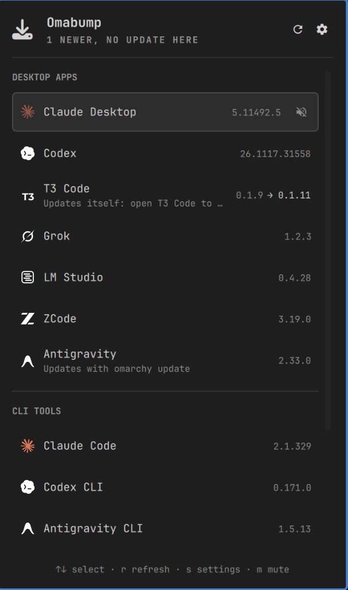
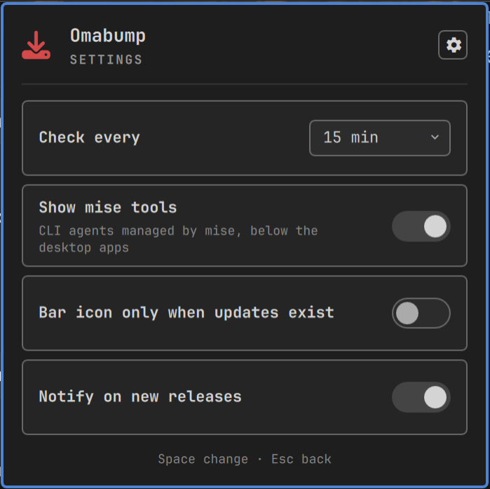
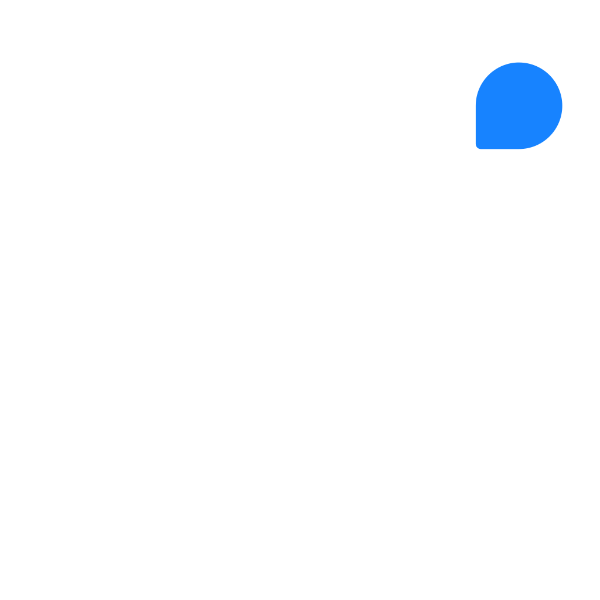
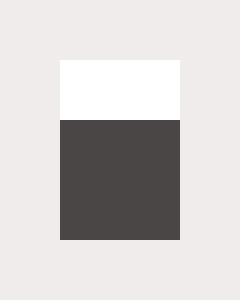
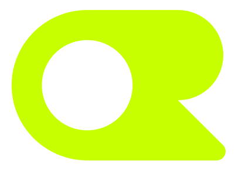

# Omabump

Updates for your AI apps and coding-agent CLIs: what is newer in Omarchy's repo, at the vendor or in mise, and a button that updates that one app.



An Omarchy bar widget. It lists the AI desktop apps and coding-agent CLIs installed on this machine, the installed and the newest version of each, and updates one app in a terminal when you press a button. It never installs anything on its own. The project was previously called Agent Apps.

Omarchy ships these apps as packages of its own pacman repo, [omarchy], built from the recipes in [omacom/omarchy-pkgs](https://github.com/omacom/omarchy-pkgs), and pacman owns their updates. Omabump works with that. For each app it shows the newest version in Omarchy's repo and the newest at the vendor, and **Update** installs the signed package from Omarchy's repo, the one `omarchy update` would install next, without waiting for it. It never builds anything.

The repo follows a vendor release after a while: usually under an hour, but measured at hours for some apps (Claude Code about 3.5 hours, Codex about 16, Pi about 25, because Omarchy holds that recipe's new releases for 24 hours). In that window the row shows the vendor's version in the warning colour. **Build now** covers it: it builds Omarchy's own recipe for that release on this machine, from a pinned omarchy-pkgs commit. It is off until you turn it on, and the package it produces is not signed by Omarchy. pacman replaces it with the repo's signed package once the repo has that version.

How it works inside, from the check's schedule to the security model, is in [docs/internals.md](docs/internals.md).

## Prerequisites

- sudo rights for `pacman -U`
- For Update: `sudo`, `curl`, `gpg` (`gnupg`), `bsdtar` (`libarchive`) and `vercmp` (`pacman`)
- For Build now, also: `base-devel` (makepkg), `git`, `jq`, `python` 3.11 or newer (what omarchy-pkgs' `bin/sync-upstream` needs), and `gpgconf` (`gnupg`)
- `mise`, optional, for the agent CLIs your own mise config still asks for
- `7zip`, optional, to read the version of an app installed as its self-updating AppImage (T3 Code); without it that row shows "version unknown"

When something is missing, the row has no Update button, or no Build now, and says what to install, for example "Missing: makepkg, jq; sudo pacman -S --needed base-devel jq".

## Install

```sh
omarchy plugin add https://github.com/vladkarok/omabump.git --enable
```

`omarchy plugin add` asks for confirmation; from a script pass `--yes`.

The widget lands in the bar's right section. Move it with `omarchy bar move io.github.vladkarok.omabump --section center --index 0` (sections: left, center, right).

## What Update and Build now do to your machine

Nothing changes until you press a button on a row. Update, Build now and Switch each open a floating terminal and run `bin/omabump-install` ([each route in detail](docs/internals.md#update-routes)):

- **Update** (`bin/omabump-install <pkg>`), on a row from Omarchy's repo (the `repo` route): downloads the package Omarchy's repo publishes and checks it before sudo: its sha256 against the repo's database, its signature with gpg in pacman's keyring (the key must be one pacman trusts fully, which is how Omarchy's own key is there), and its name and version with `pacman -Qp`. It then copies it to a root-owned directory, checks the signature again on that copy, and installs it with `sudo pacman -U`. Nothing is built and no code from omarchy-pkgs runs. It is offered when the repo has a newer package than the one installed.
- **Build now** (`b`, `bin/omabump-install --build <pkg>`), while the vendor has a release the repo does not: runs `bin/sync-upstream` and the recipe's upstream hook from the omarchy-pkgs commit this release pins ([why a pin](docs/internals.md#pinned-snapshots)), prints the recipe diff, builds the package with makepkg and installs it with `sudo pacman -U`. It runs Omarchy's build recipe as you, and the package is not signed by Omarchy. It is off until you turn it on ([Build now](#build-now)).
- **vendor** rows (ZCode): download the vendor's own Arch package over HTTPS, check it against the checksum the vendor publishes, and install it with `sudo pacman -U`.
- **mise** rows: `mise install <tool>@<version>`, with `MISE_MINIMUM_RELEASE_AGE=0` as Omarchy's own agent wrappers run it, so a `minimum_release_age` you set does not hold a release back. No sudo, and your mise config is not touched; when a lockfile keeps the old version, Update then runs `mise up <tool>`, which rewrites the lockfile.
- **Switch** (`w`, on a row installed under another package name, such as Codex as the AUR's `chatgpt-desktop` or ZCode as `z-code-bin`): `bin/omabump-install --switch <pkg>` installs the canonical package in place of the installed one, from Omarchy's repo or the vendor, and pacman asks before it removes the old package ([details](docs/internals.md#switch)). Update does the same when the repo's package is newer.
- **Omabump's own row**: a git fast-forward of the plugin's clone to the release tag, after you answer y (see [Updating Omabump](#updating-omabump)).
- **indicator** rows, and apps that update themselves, have no Update; the row says how the app updates.

Everything but the install runs as you. sudo is used for one thing: installing a package you asked for, in that visible terminal. Omabump copies the verified package into the root-owned `/var/cache/omabump` (`sudo install`), runs `sudo pacman -U` on that copy, where pacman asks before it installs, and removes the copy (`sudo rm`, or `sudo -n rm` when the run is stopped before pacman starts; the next run for that app removes a copy a run stopped during pacman left). After a vendor install it also runs `sudo rm` on `/usr/bin/<pkg>` when that is a link no package owns to a file of the installed package ([why](docs/internals.md#vendor)): while the vendor build of ZCode is installed, `zcode` is not on PATH, so start it from the app launcher or run `/opt/ZCode/zcode`. makepkg also calls `sudo pacman -S --asdeps` when a recipe's build dependencies are missing, and pacman asks before it installs them. What runs as root is pacman, the package's install script and pacman's hooks. Omabump never changes sudo configuration and never installs from the background check, which runs as you and executes nothing it downloads.

Omabump itself writes to `~/.cache/omabump`, `~/.local/state/omarchy/plugins/io.github.vladkarok.omabump`, `/var/cache/omabump` (the staged package, through sudo), the plugin's own clone in `~/.config/omarchy/plugins/io.github.vladkarok.omabump` (its own Update, whose rollback runs `git reset --hard` and `git clean -fd` there, so untracked files in it go) and, when you change a setting, Omarchy's `~/.config/omarchy/shell.json`. Beyond that, pacman installs packages, `mise install` (and `mise outdated`) may write under `~/.local/share/mise`, `mise up` rewrites a lockfile as above, and `bin/sync-upstream`, its hooks and your own `command` feeds can write wherever your user can. What runs at each step, and what each guarantee covers, is in the [security model](docs/internals.md#security-model).

A package built by Build now says `Packager: Unknown Packager` in `pacman -Qi`. pacman replaces it with the repo package once the repo's full version is higher, and `sudo pacman -S <pkg>` puts the repo package back at any time. Switching Omarchy's channel (`omarchy channel set`) runs `pacman -Syyuu --noconfirm`, which also puts the repo's older version back, without asking.

## Using it

The bar icon turns the urgent colour when an app can be updated, and the warning colour when the only news is a release the vendor has and Omarchy's repo does not. Left click opens the panel, middle or right click checks now. The tooltip and the panel header say one of: all current, N updates, N ahead of the repo (or both, as `2 updates · 1 ahead of the repo`), check failed, last known (rows that keep an earlier run's version because this run could not get one), "N newer, no Update here" (newer releases on rows without an Update button), or "All checked current, N unchecked" (rows whose newest version is not known: CLI tools whose update check was skipped, see [How CLI tools are found](docs/internals.md#how-cli-tools-are-found); a self-updating app's pre-release or unknown version; a version the local refresh found that no check has read yet), plus "(+N muted/skipped)" when quiet rows have updates. A failed or skipped check never reads as up to date; the one exception is a row you muted (see [Mute](#mute)). A check that stopped part way, killed or interrupted, says so in every bar, whoever started it.

A check runs once per interval (an hour by default), and a failed one is tried once more about 5 minutes after it started. Between checks the panel rereads the installed versions, offline, so an app updated by `omarchy update` stops offering its Update. [How both are scheduled](docs/internals.md#checks-and-the-local-refresh).

The panel has three sections: Desktop apps, CLI tools and Plugin (Omabump itself, only while it has an update or its check failed, see [Updating Omabump](#updating-omabump)). Apps and packaged CLI tools are found with `pacman -Q` (exact package names), CLI tools of mise with `mise ls`. A row shows the installed version, or `installed → newest` when there is something newer. A second line appears only for an exception: a pin, a hold and until when, another package name, a failed check, no install route, the reason Build now is not available. The row's tooltip says where the version came from and what Update runs, or why there is no Update. A row with a newer version but no button has no action, and `Enter` on it does nothing; its note and tooltip say why, and how the app updates.

### Two levels of news

| What the row shows | Meaning | Colour | Button |
|---|---|---|---|
| `→ <version>` | Omarchy's repo has a newer package than the installed one (or another route has an update) | urgent | Update |
| `→ <version>` | Only the vendor has a newer release; the repo has not caught up | warning | Build now, when the entry allows it and the tools are there |

On a row that has both, Update installs the repo's version and the tooltip also says the vendor has a newer one. Mute and skip apply to both levels. With the setting "Bar icon only when updates exist" on, the icon also shows while a row is only ahead.

### Build now

Build now is for the window between a vendor release and Omarchy's repo having it. It builds Omarchy's own recipe for the vendor's newest release, here, at the pinned omarchy-pkgs commit. It takes minutes, runs the recipe's code (its `bin/sync-upstream`, upstream hook and PKGBUILD) as you, and the package it makes is not signed by Omarchy, which Update's package is.

It is off by default (setting `buildAhead`). A row where it could run still shows it: the row's version is in the warning colour, and `b` or the Build now button explains it in the row's second line ("Build now builds <App> <version> on this machine from Omarchy's own recipe ... It is off: press b again to turn it on."). The next press turns `buildAhead` on (the button then reads Turn on), and the one after builds. Turn it on from a terminal with `omarchy bar set io.github.vladkarok.omabump buildAhead true --json`.

A row is buildable only when the vendor is ahead of the installed version and of the repo's package, its `apps.json` entry says `"build": true`, Update is not turned off for it, the build tools are installed, and the recipe has no hold or blocker. A release-age hold reads `omarchy-pkgs holds new releases for 24 h, Build now from Nov 28 14:05`. Once the repo has the version, Build now refuses and says to use Update.

Signed sources, such as Claude Code's, are verified with a keyring made for the build alone, holding only the keys the recipe ships at the pinned commit. Your own gpg keyring is not used, there is no keyserver lookup, and `--skippgpcheck` is never passed.

### Keys

Arrows or `j` and `k` select a row, `Enter` updates it, `b` is Build now on the row, `w` switches the package, `m` mutes or unmutes the row, `K` (Shift+k) skips or unskips its newest version (with CapsLock on, `j` and `k` still move the cursor), `r` checks now, `s` opens the settings, `Esc` closes. `Enter` only updates and never builds. The footer lists `b` only on a row that offers Build now (`b build now`, or `b turn on Build now` once it has been explained). The selected row always scrolls into view. The panel opens on the first row with something to do. As the rows change (a check, or the refresh on open), the cursor goes to whichever row has something to do first until you move it or act on a row; after that it stays on that app. A pointer at rest over the rows does not move it.

From a script: `omarchy-shell io.github.vladkarok.omabump status|open|close|toggle|refresh|settings` ([what each answers](docs/internals.md#ipc)).

### Settings

The gear in the panel header (or `s`) opens the settings: check interval (an hour by default, kept between five minutes and a day), show CLI tools, bar icon only when updates exist (it also shows while a check fails, and while a release is ahead of the repo), notify on new releases, and Build now.



The scripted equivalent:

```sh
omarchy bar set io.github.vladkarok.omabump <key> <value> --json
```

with the keys `refreshIntervalSec` (seconds), `showCli`, `barIconOnlyWithUpdates`, `notify` and `buildAhead`. Without `--json` the value is stored as a string; `"true"` and `"false"` are read as booleans. `showCli` was `showMise` until 0.1.19: a `showMise` in your `shell.json` still counts while `showCli` is absent, and the panel's next settings write stores `showCli` and drops it.

### Notifications

With "Notify on new releases" on, each new version is announced once, in two kinds:

- `<App> <version> available`: an update Update can install now. On a row where the vendor is also ahead, it names the repo's version.
- `<App> <version> released`, low urgency, body "Not in Omarchy's repo yet. Build now is available.": a release only the vendor has. It comes once per vendor version, and only while `buildAhead` is on and Build now could run for the row. With `buildAhead` off, an ahead row never notifies. When the repo later has that version and it is still not installed, the first kind follows.

Muted and skipped rows send neither.

### Mute

Mute (`m`, or the 󰖁 button on the row under the cursor) keeps a row in the list, dimmed with the same glyph after its name, and takes it out of every signal: no badge, no update or ahead count, no urgent or warning icon, no reason to show the bar icon when it is hidden until an update, no notification. A muted row's failed check shows only on the row itself ("Check failed: ...") and in the tooltip and IPC status ("check failed for N muted apps"), not in the header or the bar; an omarchy-pkgs or mise failure that only muted rows share does not fail the check. Its update stays visible and its buttons and Enter still work. Mute again to undo, or Clear in the settings. The list is the widget setting `mutedApps`, an array of row ids (`pkg`), set with `omarchy bar set io.github.vladkarok.omabump mutedApps '["mise:grok-cli"]' --json`. [How mute and skip are applied](docs/internals.md#mute-and-skip-in-detail).

### Skip a version

On a row with something newer, Skip (`K`, Shift+k since `k` moves the cursor, or the 󰒭 button) silences that one version the same way: the row shows `installed → newest skipped`, dimmed, and the buttons still work. When a newer version than the skipped one appears, or that version or a later one is installed, the skip no longer applies, and the row counts and notifies again (once) for a newer release. Skip again to undo. The setting is `skippedVersions`, an object of row id to version: `omarchy bar set io.github.vladkarok.omabump skippedVersions '{"grok-bot": "0.66.0"}' --json`.

Omarchy's settings schema has no array or object type, so `mutedApps` and `skippedVersions` appear only in the panel's own settings (one line, with Clear), not in the bar's widget settings.

## Supported apps

| App | Package | Route |
|---|---|---|
|  Claude Desktop | `claude-desktop` | repo, Build now |
| <picture><source media="(prefers-color-scheme: light)" srcset="assets/codex-light.svg"></picture> Codex (also found as AUR `chatgpt-desktop`) | `openai-codex-desktop` | repo, Build now |
| <picture><source media="(prefers-color-scheme: light)" srcset="assets/t3code-light.svg"></picture> T3 Code | `t3code-bin` | repo, Build now, as the `t3code-bin` package; once Omarchy's migration 1792345511 replaces it with T3 Code's self-updating app, the row shows that app's version and no Update (it updates itself) |
| <picture><source media="(prefers-color-scheme: light)" srcset="assets/hermes-light.svg"></picture> Hermes | `hermes-desktop` | repo; no Build now until the recipe has an upstream watch |
| <picture><source media="(prefers-color-scheme: light)" srcset="assets/grokbot-light.svg"></picture> Grok | `grok-bot` | repo, Build now |
| <picture><source media="(prefers-color-scheme: light)" srcset="assets/lmstudio-light.svg"></picture> LM Studio | `lmstudio-bin` | repo, Build now |
| <picture><source media="(prefers-color-scheme: light)" srcset="assets/openclaw-light.svg"></picture> OpenClaw | `openclaw` | repo as the `openclaw` package, no Update and no Build now (it is the seed of OpenClaw's own copy); once Omarchy's migration 1792334754 sets that copy up in `~/.openclaw`, the row shows its version and no Update (it updates itself) |
| <picture><source media="(prefers-color-scheme: light)" srcset="assets/perplexity-light.svg"></picture> Perplexity | `perplexity` | repo, Build now |
| <picture><source media="(prefers-color-scheme: light)" srcset="assets/zcode-light.svg"></picture> ZCode (also found as AUR `z-code-bin`) | `zcode` | vendor |
| <picture><source media="(prefers-color-scheme: light)" srcset="assets/antigravity-light.svg"></picture> Antigravity (or `antigravity-appimage`) | `antigravity` | indicator, version from the AUR; `omarchy update` updates it |
| <picture><source media="(prefers-color-scheme: light)" srcset="assets/antigravity-light.svg"></picture> Antigravity IDE | `antigravity-ide` | indicator, version from the AUR; `omarchy update` updates it |
| <picture><source media="(prefers-color-scheme: light)" srcset="assets/kimi-light.svg"></picture> Kimi | `kimi-bin` | indicator, version from Moonshot's update feed |
| <picture><source media="(prefers-color-scheme: light)" srcset="assets/trae-light.svg"></picture> Trae | `trae-bin` | indicator, version from the AUR; `omarchy update` updates it |

CLI tools Omarchy installs as packages of its repo (since its migration of 2026-11-23, which moved the coding agents from mise to pacman), listed when the package is installed. Each has Update, from Omarchy's repo (the repo route). All but OpenCode, Cursor CLI, Muse Code, DeepSeek Harness, MiniMax Code and Kilo also have Build now:
 Claude Code (`claude-code`),
<picture><source media="(prefers-color-scheme: light)" srcset="assets/codex-light.svg"></picture> Codex CLI (`openai-codex`),
<picture><source media="(prefers-color-scheme: light)" srcset="assets/grok-light.svg"></picture> Grok CLI (`grok-cli`),
<picture><source media="(prefers-color-scheme: light)" srcset="assets/copilot-light.svg"></picture> Copilot CLI (`github-copilot-cli`),
<picture><source media="(prefers-color-scheme: light)" srcset="assets/crush-light.svg"></picture> Crush (`crush-bin`),
<picture><source media="(prefers-color-scheme: light)" srcset="assets/opencode-light.svg"></picture> OpenCode (`opencode`),
<picture><source media="(prefers-color-scheme: light)" srcset="assets/cursor-light.svg"></picture> Cursor CLI (`cursor-cli`),
<picture><source media="(prefers-color-scheme: light)" srcset="assets/antigravity-light.svg"></picture> Antigravity CLI (`antigravity-cli`),
<picture><source media="(prefers-color-scheme: light)" srcset="assets/muse-light.svg"></picture> Muse Code (`muse-code`),
<picture><source media="(prefers-color-scheme: light)" srcset="assets/oh-my-pi-light.svg"></picture> Oh My Pi (`oh-my-pi`),
<picture><source media="(prefers-color-scheme: light)" srcset="assets/ori-light.svg"></picture> Ori (`openrouter-ori`),
<picture><source media="(prefers-color-scheme: light)" srcset="assets/kimi-light.svg"></picture> Kimi CLI (`kimi-code`),
 Qwen Code (`qwen-code`),
 DeepSeek Harness (`deepseek-dsh`),
<picture><source media="(prefers-color-scheme: light)" srcset="assets/minimax-light.svg"></picture> MiniMax Code (`minimax-code`),
<picture><source media="(prefers-color-scheme: light)" srcset="assets/freebuff-light.svg"></picture> Freebuff (`freebuff`),
<picture><source media="(prefers-color-scheme: light)" srcset="assets/kilo-light.svg"></picture> Kilo (`kilocode-cli`),
<picture><source media="(prefers-color-scheme: light)" srcset="assets/devin-light.svg"></picture> Devin CLI (`devin-cli`),
<picture><source media="(prefers-color-scheme: light)" srcset="assets/amp-light.svg"></picture> Amp (`amp-cli`), and
<picture><source media="(prefers-color-scheme: light)" srcset="assets/pi-light.svg"></picture> Pi (`pi-coding-agent`).

mise tools, for an agent your own mise config still asks for, listed when mise has them installed and active ([how they are found](docs/internals.md#how-cli-tools-are-found)):
 Claude Code,
<picture><source media="(prefers-color-scheme: light)" srcset="assets/codex-light.svg"></picture> Codex CLI,
<picture><source media="(prefers-color-scheme: light)" srcset="assets/crush-light.svg"></picture> Crush,
<picture><source media="(prefers-color-scheme: light)" srcset="assets/opencode-light.svg"></picture> OpenCode,
<picture><source media="(prefers-color-scheme: light)" srcset="assets/grok-light.svg"></picture> Grok CLI,
<picture><source media="(prefers-color-scheme: light)" srcset="assets/copilot-light.svg"></picture> Copilot CLI,
<picture><source media="(prefers-color-scheme: light)" srcset="assets/cursor-light.svg"></picture> Cursor CLI,
<picture><source media="(prefers-color-scheme: light)" srcset="assets/pi-light.svg"></picture> Pi,
<picture><source media="(prefers-color-scheme: light)" srcset="assets/oh-my-pi-light.svg"></picture> Oh My Pi,
<picture><source media="(prefers-color-scheme: light)" srcset="assets/ori-light.svg"></picture> Ori,
<picture><source media="(prefers-color-scheme: light)" srcset="assets/antigravity-light.svg"></picture> Antigravity CLI,
<picture><source media="(prefers-color-scheme: light)" srcset="assets/amp-light.svg"></picture> Amp,
 Qwen Code,
<picture><source media="(prefers-color-scheme: light)" srcset="assets/kilo-light.svg"></picture> Kilo,
<picture><source media="(prefers-color-scheme: light)" srcset="assets/kiro-light.svg"></picture> Kiro CLI,
<picture><source media="(prefers-color-scheme: light)" srcset="assets/devin-light.svg"></picture> Devin CLI,
 DeepSeek Harness,
<picture><source media="(prefers-color-scheme: light)" srcset="assets/minimax-light.svg"></picture> MiniMax Code,
<picture><source media="(prefers-color-scheme: light)" srcset="assets/commandcode-light.svg"></picture> Command Code,
<picture><source media="(prefers-color-scheme: light)" srcset="assets/freebuff-light.svg"></picture> Freebuff,
<picture><source media="(prefers-color-scheme: light)" srcset="assets/muse-light.svg"></picture> Muse Code,
<picture><source media="(prefers-color-scheme: light)" srcset="assets/kimi-light.svg"></picture> Kimi CLI,
 Gemini CLI,
 Jules, and
<picture><source media="(prefers-color-scheme: light)" srcset="assets/herdr-light.svg"></picture> herdr.
An agent Omarchy adds later needs an entry: until a release has it, add one to your own `apps.json`.

## Adding an app

`~/.config/omarchy/omabump/apps.json` is merged over the shipped `apps.json` by `pkg`: a new `pkg` adds an app, an existing one overrides the fields it sets, and `"disabled": true` hides one.

```json
[
  { "pkg": "lmstudio-bin", "disabled": true },
  {
    "pkg": "my-app",
    "label": "My App",
    "source": "vendor-pkg",
    "vendorPkg": { "x86_64": "https://example.com/{version}/my-app-{version}-x86_64.pkg.tar.zst" },
    "checksum": { "url": "https://example.com/{version}/SHA256SUMS", "algo": "sha256" },
    "feed": { "type": "github-release", "repo": "owner/my-app" }
  }
]
```

A package of Omarchy's repo takes `"source": "repo"`. Its newest version is then the repo's. A `feed` is optional: with one, the row also knows the vendor's newest release and can show it ahead of the repo; without one, the row is never ahead. `"build": true` lets Build now build the entry's recipe, which needs the recipe to exist in omarchy-pkgs:

```json
{ "pkg": "my-agent-cli", "label": "My Agent", "source": "repo", "section": "cli", "build": true,
  "feed": { "type": "github-release", "repo": "owner/my-agent" } }
```

An entry from before 0.2.0 with `"source": "omarchy"` still works: it is read as `repo` with `"build": true`, unless the entry sets `build` itself.

Every field, and every kind of feed, is in the [apps.json reference](docs/internals.md#appsjson-fields).

## Updating Omabump

`omarchy update` updates Omarchy and your packages, not plugins. So Omabump checks its own GitHub release too, and shows a Plugin section with an Omabump row while a newer release exists or that check failed. Its Update prints the release's commits and a diffstat, asks `Update Omabump to <version>? [y/N]`, and on `y` fast-forwards the plugin's clone to the release tag, validates the plugin and reloads the shell's plugins. If that fails, the clone goes back to the installed commit and the old version stays. `omarchy restart shell` then loads the new panel code. Mute and skip work on this row too (`self:omabump`). [What it checks first, and the rollback](docs/internals.md#omabump-itself).

`omarchy plugin update io.github.vladkarok.omabump`, run by hand, still follows the repository's HEAD, which can be ahead of the release. A plugin directory that is a symlink or has no `.git` (a developer checkout) shows "Local checkout, update it with git" and no Update button.

## Remove

```sh
omarchy plugin remove io.github.vladkarok.omabump
```

That leaves the cache (the omarchy-pkgs clone, downloaded recipe sources, any failed build) and the state directory (the last check, which versions were announced). Remove them with:

```sh
rm -rf ~/.cache/omabump
rm -rf ~/.local/state/omarchy/plugins/io.github.vladkarok.omabump
rm -rf ~/.config/omarchy/omabump   # only if you created overrides
sudo rm -rf /var/cache/omabump     # only if a staged package failed its check or a stopped run left one
```

Packages Omabump installed stay installed; pacman manages them like any other.

## Internals

[docs/internals.md](docs/internals.md) has the rest: how checks and the local refresh are scheduled, exit codes, status.json, how CLI tools are found, each route in detail (Update, Build now, Switch), the pinned omarchy-pkgs snapshot and its weekly watch, the security model, the hosts and GitHub API calls Omabump makes, every apps.json field, and how to run the tests.

## Tested on

Omarchy 4.0.0 r6692 (host and a lab VM), Quickshell 0.3.1, x86_64.

## License

MIT, see [LICENSE](LICENSE).

Most marks in `assets/` are copied from Omarchy's first-party Agents plugin or extracted from Omarchy's icon font (`omarchy.ttf`), MIT licensed; `gemini.svg` and `trae*.svg` are from LobeHub `lobe-icons` (MIT), `jules.svg` is from `theSVG` (MIT), and `herdr*.svg` is drawn for this plugin. All brand marks belong to their respective owners.
